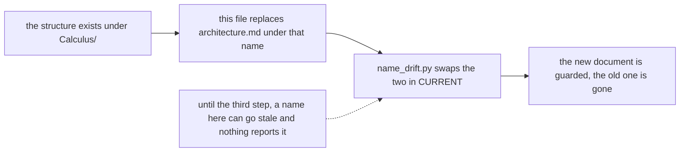
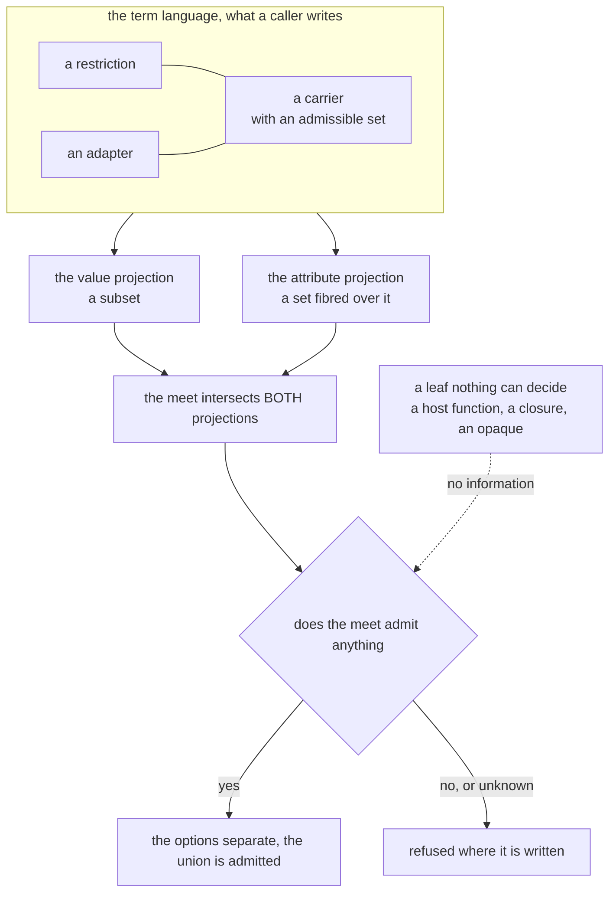
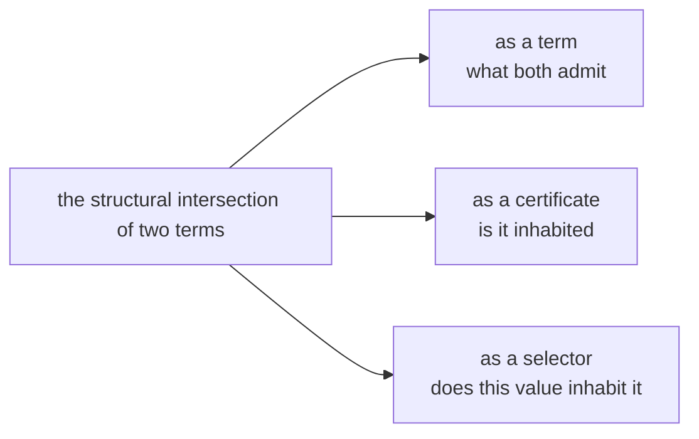
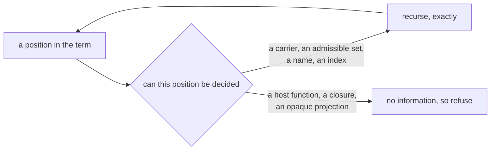
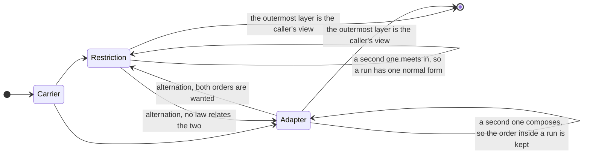

# Architecture of the Lean development, version 2

**THIS DOCUMENT DOES NOT GOVERN YET.** `docs/architecture.md` is the normative description of
the system as it stands. This file describes the system the arc is building toward. Where the
two disagree, `architecture.md` is right about today and this file is right about the intent.

Read this before proposing a change to the term language, so that a pass moves toward the target
rather than away from it.

## How this file stops being a draft

Three things happen together, and none of them is a judgment call.

1. The structure below exists under `Calculus/`.
2. This file replaces `docs/architecture.md`, under that name.
3. `formal/scripts/name_drift.py` swaps the two in its `CURRENT` list.

Point 3 is the one that matters and the reason the other two are written down. **This file is
not name-checked today**, because every guarded document is in that list and this one is not.
A guarded document cannot cite a declaration that does not exist, and this file cites several on
purpose. So it carries the risk that every unguarded document carries: a name here can go stale
and nothing reports it. Treat a name in this file as a proposal, and the tree as the authority.

This file carries no count, no line number, no measurement and no section number, for the
reason `architecture.md` gives. A renumbering must not be able to make a sentence here wrong. The measurements that produced this design, the probes that tested it,
and the decisions still open are in the repository memory, not here. A reader who needs the
evidence reads that. A reader who needs the intent reads this.

| For | Read |
| --- | --- |
| The system as it stands, normatively | `docs/architecture.md` |
| The rules, normatively | `formal/docs/blueprint/src/content.tex` |
| Future states, and what decides each | `docs/roadmap.md` |
| Known, suspected and partially mitigated issues | `docs/defects.md` |
| The evidence, the probes and the open decisions | the repository memory |

---

## The map

**The prose governs and a diagram illustrates it.** Where a diagram and a sentence disagree, the
sentence is right and the diagram is the defect. Nothing checks these pictures, so read one as a
summary of the section it sits in and never as the source of a claim.

The two projections are different kinds of set, and the meet intersects each of them. They are
inhabited together, so one decision settles both. The undecidable leaf is the only place
information is lost, and an unknown answer refuses rather than admits.

---

## 1. The one question, asked twice

A term denotes a codec: a partial write from a value to an attribute, and a partial read back.
A union holds options, and the calculus decides at declaration time whether the options can be
told apart, because selection must find at most one option claiming a given thing.

**The write and the read are not inverse, and that is the reason this question is two questions.**
A read after a write returns the value that was written. A write after a read returns an
attribute that only *agrees* with the one that was read. So the read accepts a whole class of
attributes where the write produces one, and the set of attributes a term accepts is strictly
larger than the set it produces.

**A term therefore has two projections, and neither determines the other**: the values it writes,
and the attributes it accepts. A term is not a partial bijection between them, and any reasoning
that treats it as one collapses two independent facts into a single one. The calculus carries
both projections for this reason and not for symmetry.

### The object is a retract

The write is a section and the read is its retraction. That single fact fixes the shape of both
projections and they come out as different kinds of object.

    the value projection       a SUBSET of the value universe
    the attribute projection   a set FIBRED over that subset
    the write                  a choice of one representative in each fibre

Every attribute the read accepts lands on some value, and the attributes landing on one value are
that value's fibre. The write picks one of them, so the attributes a term produces are a section
of the attributes it accepts, never all of them.

**A subset and a fibred set are compared by different means, so no reasoning unifies the two
projections.** An argument that treats the attribute side as a subset of the values, or derives
one projection from the other by injectivity, has discarded the fibres. Each such argument looks
like a symmetry and is a category error, and the calculus carries two projections because there
are two kinds of thing here, not two spellings of one.

"Told apart" is two questions.

    no value is written by two options
    no attribute is read by two options

A pair disjoint on one side alone is not disjoint. Two terms can write different value kinds and
store at the same member, and then encoding is unambiguous while decoding is not.

So every operation here answers one shape of question: **is the intersection of two described
sets empty?**

## 2. Where the certificate lives

### One relation, three uses

The meet is structural intersection. It takes two terms and returns the term that admits exactly
what both admit, or reports that it cannot tell. Everything the calculus needs is a use of it.

    the meet         the intersection itself, as a term
    the certificate  is that intersection inhabited
    the selector     does this value inhabit it

There is no second apparatus. A certificate that is not the inhabitance of the meet is a second
function that must be held in agreement with the meet by hand, and nothing holds it there.

### The selector decides by attempt, at every constructor

An option admits a value when the option's codec accepts it. That is one rule, and it recurses
because a codec recurses.

A selector that decides an object by its key set and its literal marks is a narrower thing: a
dispatch on discriminants. It is cheap, it is shallow, it is what a host does when it dispatches
a tagged union, and **it is not admission.** A calculus built on it inherits the depth limit.
The same fact then separates one level in and vanishes two levels in, and a position the
dispatch never reads, such as a list index, never separates at all.

**This document rules for attempt, at every constructor including the object.** The cost is real
and named below. What it buys is that the certificate has nothing left to approximate except
where approximation is forced.

### The abstraction is confined to the leaves

Write `S t` for a set a term claims and `[t]` for its description, with `g` turning a description
back into a set. Three laws carry the design.

    S t  ⊆  g [t]                    a description OVER-approximates
    g (a ⊓ b)  ⊇  g a ∩ g b          the meet over-approximates the intersection
    g ⊥  =  ∅                        the bottom stands for the empty set

**The laws are generic in the side, and both instances are required.** Separation is two
questions, so `S` has two readings: the values a term writes, and the attributes a term reads.
Each carries its own description, its own meet and its own bottom, and the three laws hold of
each.

With admission by attempt, `g` is the identity at every constructor: a carrier, an admissible
set, a name, a position. It over-approximates only where a leaf cannot be decided.

**That is the whole of the incompleteness and it is local.** It sits at named leaves, it does not
accumulate with depth, and it is the honest answer at each of those leaves rather than a gap
somebody has not closed yet. Disjointness proved over descriptions transfers to the concrete
sets and never upward, which is what an abstraction is:

    ∅  =  g ⊥  =  g ([x] ⊓ [y])  ⊇  g [x] ∩ g [y]  ⊇  S x ∩ S y

Nothing in that chain runs backwards.

### Inhabitance propagates by position

    the intersection of two one-position tuples over disjoint types   is the bottom
    the intersection of two arrays over disjoint types                is an array of the bottom

A required position passes the bottom upward. A variadic one does not, because the empty list
inhabits an array over the bottom. Nothing states that rule twice: it follows from the position
being required or variadic, and it is the same rule a structural type system applies when it
intersects a tuple and when it intersects an array.

### What the ruling deletes

An occupancy projection over a finite index of value slots and attribute members. A presence
test at a name. A literal test at a name. A row for each written shape. A body specification
carried beside the term so that a test can read it without consulting a codec.

Every one of them is the recursion truncated at some depth. Each owes its own soundness proof,
its own argument that the indices it skips could not have separated, and its own extension on
the day the language gains a constructor. **The recursion owes one proof and gains nothing on
that day.**

### The cost, stated plainly

Deciding an object by attempt reads every field through that field's codec. A dispatch on keys
and discriminants is a lookup. That is a genuine trade at run time, it is measurable rather than
arguable, and this ruling accepts it. A host that needs the cheap dispatch can keep one, as an
optimisation that must agree with admission, never as the definition of it.

### The constructors are universal constructions, and the laws arrive with them

A constructor of the term language is one of five things, and which one it is fixes the laws the
meet owes at that position before anybody writes the row.

| construction | in the language | what the meet owes |
| --- | --- | --- |
| a base | a ground carrier, an opaque projection | nothing beyond its own set |
| a **product** | an object, a tuple, an array | meet componentwise; the bottom propagates at a required position and not at a variadic one |
| a **coproduct** | a union, a name's absent-or-present | a unit law; disjoint injections; the meet distributes over it |
| a **subobject** | a restriction | the predicates **meet**: idempotent and commutative |
| a **composition** | an adapter | associative, unital, not commutative |

Compare a term with itself and the meet returns a **normal form** rather than the term as
written: a union of one option reduces to that option, a transparent wrapper disappears, and a
restriction is carried as written. So the meet is not tested by syntactic equality, and a test
that uses it reports a normalization as a broken law.

**The meet obeys these laws at every construction above.** The gap is not in the meet.

### Inhabitance is a decision, and testing for the bottom is its shadow

The certificate asks whether the intersection is inhabited. A term that denotes the empty set is
not always **spelled** as the bottom: intersecting two restrictions over one carrier pinned to
disjoint sets yields the carrier under both restrictions, which is empty and is spelled as a
restriction. A certificate that compares the meet against the bottom therefore misses it.

**So the missing object is a decision procedure for inhabitance, not a repair at one
constructor**, and it settles the value projection alone. The attribute projection is a different
kind of set and takes the recursion below. The bottom is one syntactic witness of an empty term. The bottom rising through a
required position of a product and stopping at a variadic one is a second, already written into
the meet by hand. Disjoint restrictions over one carrier are a third, and nothing decides it.
Each further witness written by hand is another truncation, for the same reason a test per shape
was one.

Decided structurally, inhabitance costs one function and every construction contributes one case,
which is where the work belongs. A constructor added later arrives with its case known in
advance. A construction nobody has tested still owes its laws: the meet's associativity, its
distribution over the coproduct, and the adapter's unit are not established here.

### The two projections are inhabited together, so one decision settles both

The meet intersects **both** projections, and each has its own homomorphism law: the values the
meet admits are the values both factors admit, and the attributes the meet accepts are the
attributes both factors accept.

Now take any one term and use the retraction law and the canonicity law alone.

    it admits a value      →  the value writes an attribute  →  retraction  →  that attribute is accepted
    it accepts an attribute →  the attribute reads a value   →  canonicity  →  that value is written

**So a term's two projections are inhabited together.** Apply that to the meet of two options and
the consequence is immediate: the value projections are disjoint exactly when the meet admits no
value, the attribute projections are disjoint exactly when the meet accepts no attribute, and
those two conditions are the same condition.

**Separating on both sides is therefore one question about the meet rather than two.** It needs no
second apparatus on the attribute side, no comparison of shapes, and no assumption that acceptance
is closed under anything. A design that builds a separate attribute-side recursion has duplicated
a decision that the meet already carries.

The derivation uses the retraction and the canonicity laws and nothing else. Both belong to the
weaker bundle that a term containing an alternate reader still satisfies, so the collapse holds
there too. What it does rest on is that the meet of lawful terms is itself lawful, and **that is
the load-bearing obligation of this design.** It is one preservation theorem rather than a family
of them.

### The attribute side is a fibred set, and the certificate does not read it

For completeness rather than for use: the attribute side admits a ladder of descriptions, from
the outermost member, through the member at every position recursively, to the fibres the codec
actually distinguishes, to the raw wire. The recursive one is in the development and is proved to
refine the member.

**None of that is the certificate's business.** The meet intersects acceptance directly, and the
collapse above makes one inhabitance decision settle both projections. The ladder describes the
structure of the attribute side; it does not supply a test, and a design that reaches for it has
mistaken a description for a mechanism.

### The lattice is complete and the term language is not

The term language has a bottom and no top. No term admits every value, because a term denotes a
codec and no codec encodes every value.

The description has a top and needs one: an undecidable leaf answers with it, and the value side
of an uncertified adapter is it. So **the top belongs to the description and not to the term language**, and the
asymmetry is forced rather than missing. A host constructs the top's **projection**, never the
top: the opaque term is that projection, and its flag says whether the projection loses.

## 3. What the structure demands of any description

Each demand below is a constraint on any description, and each already has something in the
development that meets it. The diagram is that pairing; the text is the reason.

```mermaid
requirementDiagram
  requirement D1 {
    id: D1
    text: a description answers at every index including the undeclared one
    risk: high
    verifymethod: test
  }
  requirement D2 {
    id: D2
    text: the description of a sum meets summand by summand
    risk: high
    verifymethod: test
  }
  requirement D3 {
    id: D3
    text: a restriction names the carrier it restricts
    risk: medium
    verifymethod: inspection
  }
  requirement D4 {
    id: D4
    text: a projection keeps every fact the certificate reads
    risk: high
    verifymethod: test
  }
  requirement D5 {
    id: D5
    text: analysability is whether the premises are discharged
    risk: medium
    verifymethod: demonstration
  }
  requirement D6 {
    id: D6
    text: every test computes and no route reaches a classical axiom
    risk: high
    verifymethod: test
  }
  requirement D7 {
    id: D7
    text: a concept leaves the language exactly when it is terminal in it
    risk: low
    verifymethod: inspection
  }

  element nameSum {
    type: description
  }
  element members {
    type: constructor
  }
  element structuralAdmission {
    type: relation
  }
  element certifiedAdapter {
    type: constructor
  }
  element mutualInclusion {
    type: instance
  }
  element alternateReader {
    type: field
  }

  structuralAdmission - satisfies -> D1
  nameSum - satisfies -> D2
  members - satisfies -> D3
  structuralAdmission - satisfies -> D4
  certifiedAdapter - satisfies -> D5
  mutualInclusion - satisfies -> D6
  alternateReader - satisfies -> D7

  requirement D8 {
    id: D8
    text: the selector and the certificate are one relation
    risk: high
    verifymethod: test
  }
  requirement D9 {
    id: D9
    text: the meet of lawful terms is lawful
    risk: high
    verifymethod: test
  }
  structuralAdmission - satisfies -> D8
  structuralAdmission - satisfies -> D9
```

The members constructor is a declaration in `Calculus/` today. The other elements are concepts
this design names and the development does not: read them as the shape a satisfying declaration
must take, not as something to grep for.

**`D4` is the demand the ruling repays.** A projection can drop a fact the certificate needs, and
under a dispatch on discriminants every field's type was such a fact. Admission by attempt
projects nothing away except at a leaf it cannot decide, so `D4` stops being a standing debt and
becomes a property of the one relation.

**D1. A description is total over its index.** A description answering only at declared names is
a partial function pretending to be total, and every reader then carries the undeclared case by
hand. The undeclared case is a value of the description: an open block claims every name, a
closed body refuses every name it does not declare.

**D2. A description of a sum is a sum.** A name admits absence, or presence carrying a value.
That is a sum, and a sum's description meets summand by summand, reaching the bottom only when
every summand does.

    sum       (a1 + p1) ⊓ (a2 + p2)  =  (a1 ⊓ a2) + (p1 ⊓ p2)      ⊥ iff BOTH are ⊥
    product   (f1 , v1) ⊓ (f2 , v2)  =  (f1 ⊓ f2 , v1 ⊓ v2)        ⊥ iff EITHER is ⊥

Storing a sum as two independent fields and meeting them separately meets the product. The two
tests are different, and the difference is not a matter of strength in one direction: the
product form asks a question about one coordinate at a time, so a pair that overlaps in every
coordinate while every summand pair is empty is invisible to it.

A name is the worked instance: absent, or present carrying a value. The intersection of two
names is the intersection of the absent cases beside the intersection of the present ones, so a
name separates only when both summands do. A width-open body admits every unnamed key, so its
absent case is empty and two open bodies overlap where two closed ones separate.

**D3. A restriction has a carrier.** A restriction with no carrier describes a set no term
describes, so the abstraction has nothing to abstract, and only the top can approximate it.

**D4. A projection keeps what the decision reads.** A description that drops a fact the
certificate needs is blind by construction, and no proof recovers it. A projection is part of the
abstraction and owes the same soundness as the rest.

**D5. Analysability is a field, and the field is whether the premises are discharged.** An
arbitrary host predicate forces the description to the top there, and that is forced: keeping
discriminating power over an arbitrary predicate needs a solver over a restricted logic or a
syntactic reading of control flow, and neither survives a kernel decision procedure.

The cut is not data against function, because the system ships functions and knows what they do.
It is not the system's against the caller's either, because that is privilege rather than
structure. **It is whether the premises are discharged, and certification is open.** A caller
who discharges the laws earns what the library earns.

**D6. The description decides in the kernel.** Every test the certificate runs computes, and no
route reaches a classical axiom. The constraint is sharper than it sounds and it has a known
answer, so read both halves together.

Equality on a finite index computes. Mathlib's `DecidableEq (Finset a)` does **not**: its
instance reaches `Classical.choice`, and a certificate settled by `decide` inherits whatever its
instances reach. A leak of exactly that shape entered once through a definition rather than a
proof, and no review of the tactics finds one.

**It does not follow that a description cannot hold a set.** Two routes stay inside the kernel,
and both are in the development already. Membership needs equality on the element alone, which
computes, so a test can quantify over a set without ever comparing two sets. Where two sets must
be compared, mutual inclusion decides equality and is choice-free.

So `D6` constrains how a set is *used* and not whether a description may carry one. A test that
quantifies over the declared names owes one more thing: a theorem that the names it skips could
not have separated anyway. A width-open body is why the obligation is real, because such a body
answers at a name it never declared.

**D7. A concept lives outside the language exactly when it is terminal in it.** If no constructor
position accepts a concept, moving it outside removes a row from every table and closes off
nothing reachable. If any position accepts it, moving it outside makes a reachable state
unwritable, and encoding exists to do the opposite. The alternate reader is terminal and sits
outside. An adapter is a union option and composes with itself, so it is a constructor.

**D8 and D9 constrain the certificate rather than a description**, and D9 is what remains after
the demand it began as turned into a consequence, and the rest of this document
leans on both without having stated either.

**D8. The selector and the certificate are one relation.** The certificate asks whether any
value can inhabit two options. The selector asks whether this value inhabits one. A certificate
that separates what the selector cannot tell apart is **unsound**, because the run time then
finds two claimants. A selector that tells apart what the certificate cannot is **wasted**,
because the union is refused where the codec would have worked. Two functions kept in agreement
by hand will drift, and nothing reports the drift. So they are one function at two arguments.

**D9 is withdrawn as a demand.** It said a certificate must separate on the value side and on the
attribute side. That is true and it is a consequence rather than an obligation: the retraction and
canonicity laws make a term's two projections inhabited together, so one inhabitance decision on
the meet settles both. What replaces it is the preservation obligation above, that the meet of
lawful terms is lawful, which is what the consequence rests on. A recursion may discharge both at
once where the codec makes them one fact, as a literal does, but it may never discharge one and
stay silent about the other.

---

## 4. The term language

### A carrier and a restriction, and an adapter beside them

A literal and a refinement both restrict what a carrier accepts, differing only in the size of
the set. **A set of admissible values is one concept, a literal is its singleton, and a bare
carrier is the whole set.** A type and a discriminant stop being different kinds of thing, which
is the symmetry the old arrangement broke: it gave a literal the power to separate and gave a
type none. One relation over admissible sets decides both, at every depth, in every position.

An adapter does not restrict. It **re-indexes**, which is why it commutes with nothing: a
refinement outside an adapter tests the caller's value and the same refinement inside tests the
carrier's. Those are different facts and both are wanted, so the two orders are not collapsed.

    Restriction   a predicate on one value        commutative, idempotent, associative
    an adapter    a change of coordinates         associative, a unit, NOT commutative

Those are different algebras, and the difference is the whole reason the two stay apart. The
restrictions around one carrier form a meet-semilattice, so a run of them has one normal form
and the order inside the run carries no information. An implementation may carry a run as written
rather than reduce it, which costs nothing while the reader of the term decides inhabitance
rather than reading the spelling. The adapters form a monoid, so a run of
them composes, and the order inside the run carries everything.

Restrictions compose, because an adapter needs a second restriction naming the values it owns.

### The alternating stack

A term is a carrier with layers around it, and the two algebras give it a normal form. Adjacent
layers of one kind collapse: a run of restrictions meets to one restriction, a run of adapters
composes to one adapter. A mixed pair does not collapse, because no law relates them. So every
term is a carrier under an **alternating word**, and two terms that differ only inside a run are
one term.

That is what makes the stack a mechanism rather than a list. A reader knows where a run ends
without looking at its contents, and the description below reads the word positionally.

**The stack bottoms out at a wire carrier, and a base is not one.** A base of the language is an
adapter, so the platform-number base is an adapter over the decimal carrier rather
than a carrier itself. A carrier is therefore a kind the wire format has, with nothing beneath
it, and the set of carriers is smaller than the set of things a caller may write at the bottom
of a stack. Read the start of the diagram as the wire, not as the vocabulary.

The description does not collapse it either. **The value side of a description lives at the
caller's level**, so the rule is positional: read every restriction outside the outermost
adapter directly, and take the top from the outermost adapter inward. Nothing crosses an
adapter, so nothing is transported, so no property of an adapter's function is ever required.

The stored side needs no rule. An adapter is transparent there, so the description reads through
the whole stack to the carrier.

### An adapter's domain

A host type is erased before the certificate's question is asked. So a distinction living only
in the host's types buys nothing, and an adapter's value domain falls in three cases: one the
runtime can test, two brands over one carrier that it cannot, and a brand against its own
carrier which is not disjoint at all.

**Which values an adapter owns is a restriction on values, so it is an operand and not an
obligation.** An adapter carrying a domain test is two restrictions composed, and its value side
stops being the top. Where no test is given the top is correct, and **the refusal is the product
working** rather than a gap in it.

### A name description is an admissible set

A name admits absence, or presence carrying a value. That is one set and one emptiness test, not
two coordinates tested apart with a presence equality guarding the second. The guard is the
absent summand, and writing it by hand is what makes a pair separated by the two summands
together go unseen.

A name's description reaches the field's term, not a summary of it. Two objects declaring one
name at two different types are separated by that name, at any depth, because the relation at
the name is the relation itself.

A set of admissible values is not a new representation. The members of a refinement are already
a non-empty finite set over the carrier's type, so unifying a literal with a refinement merges
two representations rather than introducing one. What the unification inherits is `D6`'s
discipline: quantify by membership, decide equality by mutual inclusion, and never reach for the
classical instance.

---

## 5. What is host-relative, and what is not

**The value universe is the host's, and the core currently fixes one.** It names an opaque
numeric type concretely and carries no decimal carrier, so a decimal value is a text value.
Those are host facts, not laws: a host with an arbitrary-precision primitive separates them.

Everything derived from that collapse is therefore a property of a chosen universe. The text
base and the decimal base sharing a value slot while storing at different members is one such
thing, and so is every refusal that follows from it.

**The core already knows how to state premises instead of fixing an instance.** The numeric host
is a structure over any carrier, with a spelling, a reader, a round trip and a decidable
equality, and it has inhabitants that need no opaque type at all. That is the pattern: the core
states what a host must provide, the host provides it, and the term references it.

**A base of the language is an adapter.** The platform-number base and the host-independent
decimal base have the adapter's signature exactly: the stored side passes through and the value
side is re-indexed, with the round trip proved rather than promised. A number literal is a
decimal literal under that adapter. So an adapter is native to the language rather than an escape
hatch added to it.

---

## 6. What this architecture does not reach

- **Relational separation.** The recursion reads one name at a time. A pair separated only by a
  correlation between two names is unreachable.
- **An adapter's value side where the caller states no domain.** The top is forced there, and it
  is the honest answer: nobody can decide it.
- **A cheap dispatch.** Admission by attempt reads every field through that field's codec. A host
  may keep a discriminant dispatch as an optimisation that agrees with admission, and nothing
  here derives one for it.
- **A top in the term language.** Forced: a term denotes a codec, and no codec encodes every
  value.
