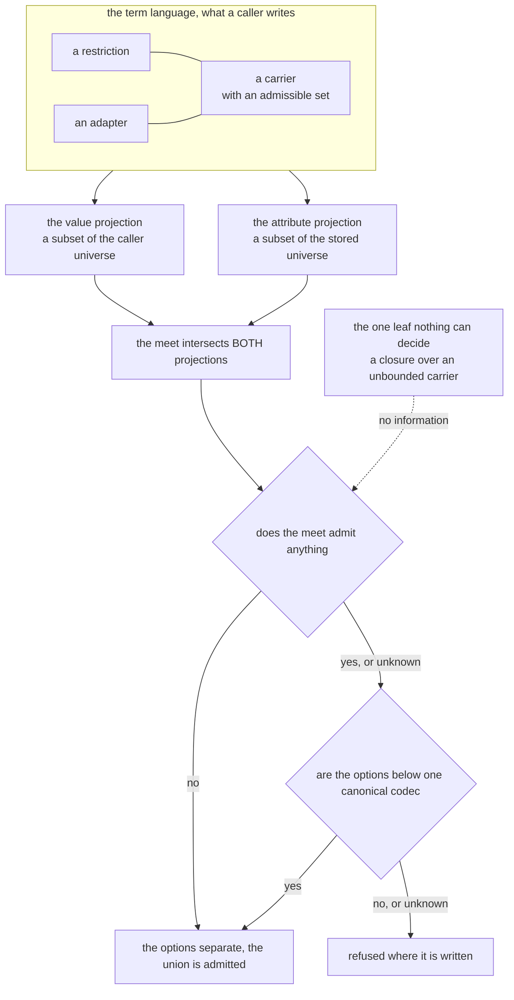
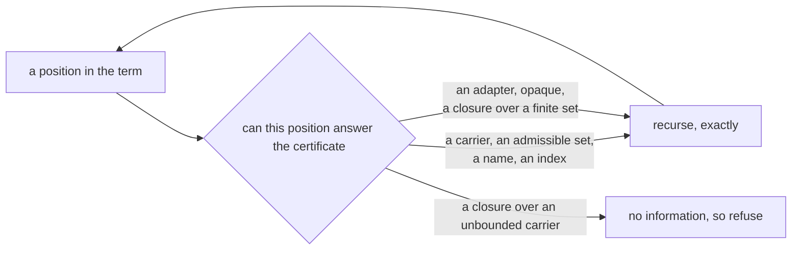
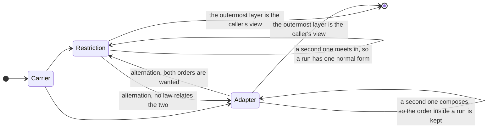

# Architecture of the Lean development, version 2

**THIS DOCUMENT DOES NOT GOVERN YET.** `docs/architecture.md` is the normative description of
the system as it stands. This file describes the system the arc is building toward. Where the
two disagree, `architecture.md` is right about today and this file is right about the intent.

Read this before proposing a change to the term language, so that a pass moves toward the target
rather than away from it.

## How this file stops being a draft

Three things happen together, and none of them is a judgment call.

1. The structure below exists under `Calculus/`.
2. This file replaces `docs/architecture.md`, under that name.
3. `formal/scripts/name_drift.py` swaps the two in its `CURRENT` list.

**This file is not name-checked today**, because it is not in that list, and it cites several
declarations that do not exist on purpose. A name here can go stale and nothing reports it. Treat
a name in this file as a proposal, and the tree as the authority.

Two tags mark a paragraph whose statement the tree does not carry yet. A block that starts
`> ASPIRATION:` follows a statement that is a target, and says what is missing. A block that
starts `> OPEN (owner):` follows a statement that waits on a decision of the owner. A paragraph
with no tag describes structure that exists under `Calculus/` or in the library.

This file carries no count, no line number, no measurement and no section number, so that a
renumbering cannot make a sentence here wrong. The evidence for this design is in the repository
memory.

| For | Read |
| --- | --- |
| The system as it stands, normatively | `docs/architecture.md` |
| The rules, normatively | `formal/docs/blueprint/src/content.tex` |
| Future states, and what decides each | `docs/roadmap.md` |
| Known, suspected and partially mitigated issues | `docs/defects.md` |
| The evidence, the probes and the open decisions | the repository memory |

---

## The map

**The prose governs and a diagram illustrates it.** Where a diagram and a sentence disagree, the
sentence is right and the diagram is the defect. Nothing checks these pictures, so read one as a
summary of the section it sits in and never as the source of a claim.

---

## 1. The one question, asked twice

A term denotes a codec: a partial write from a value to an attribute, and a partial read back.
A union holds options, and the calculus decides at declaration time whether the options agree
where they overlap.

**The write and the read are inverse on every term whose obligations hold.** A read after a write
returns the value that was written. A write after a read returns the attribute that was read,
because the reads of a lawful codec are canonical. So such a term is a partial bijection between
values and attributes, and its read is injective (`Lawful.ker_eq`). A union of incompatible options
is a term that breaks its obligation, and it is not a partial bijection.

### The object is a partial bijection, and the fibres belong to the port

**A store can spell one value in several ways**, as DynamoDB spells one number in several ways.
The read of the store accepts every spelling, and the write picks one. That is a canonizer in
front of the term, not a property of the term, so it lives in the port with the other facts of
the store. A codec that reads more than one spelling of one value is not lawful
(`Lawful.fmt_subsingleton`), and so it is not a term.

**The two projections ask two questions where the two sides can come apart.**

    the values it writes       a subset of the caller's universe
    the attributes it reads    a subset of the stored universe

For a term with no adapter the two universes are one, identified by `opaque`, and the two
questions have one answer. An adapter is the one construct whose two sides lie in two universes,
so a pair that holds an adapter asks both questions.

"Told apart" is two questions.

    no value is written by two options
    no attribute is read by two options

A pair disjoint on one side alone is not disjoint. Two terms can write different value kinds and
store at the same member, and then encoding is unambiguous while decoding is not.

So every operation here answers one shape of question: **is the intersection of two described
sets empty?** A union asks one more: **do the two options agree where they meet?**

## 2. Where the certificate lives

### One relation, three uses

The meet is structural intersection. It takes two terms and returns the term that admits exactly
what both admit, or reports that it cannot tell. Everything the calculus needs is a use of it.

    the meet         the intersection itself, as a term
    the certificate  is that intersection inhabited
    admission        does this value inhabit it
    compatibility    does the meet exist, with the domain and the range of the two meets

The meet answers two questions. Its emptiness decides whether two options are orthogonal. Its
existence decides whether they are compatible: two partial bijections are compatible exactly when
their meet exists and its domain and range are the meets of theirs. A meet that cannot tell is a
decline on both questions, not a refutation.

> ASPIRATION: no declaration decides compatibility through the meet, and the meet refuses an
> adapter beside every term but the bottom. A meet row for two adapters must decide whether
> their functions are equal, and a function has no decidable equality. The link between
> compatibility and the meet is a theorem of inverse monoids, not yet of this development.

There is no second apparatus: the certificate is the inhabitance of the meet. Two terms whose
domains and ranges meet at the bottom are orthogonal, and the meet of two orthogonal elements is
the bottom (Lawson, *Primer on inverse semigroups I*, Lemma 2.16). The domain and the range of a
term are its two views, so the meet answers the bottom there.

### Admission is by attempt, at every constructor

An option admits a value when the option's codec accepts it. That is one rule, and it recurses
because a codec recurses.

A selector that decides an object by its key set and its literal marks is a dispatch on
discriminants, and **it is not admission.** A calculus built on such a dispatch inherits its
depth limit: a fact separates one level in and vanishes two levels in, and a position the
dispatch never reads, such as a list index, never separates at all.

**Admission is by attempt, at every constructor including the object.** The certificate then has
nothing left to approximate except where approximation is forced.

### A union is lawful by compatibility, and no option owns an overlap

Two options are compatible when they agree wherever they overlap: an attribute that both read,
they read to one value, and a value that one reads, the other leaves alone or reads the same way.
A union of compatible options is lawful where it acts, with no certificate. Orthogonality is the
case with no overlap.

**Two options below one canonical codec are compatible.** Every term with no adapter is below
`opaque`, which is why such options never conflict. Two restrictions of one adapter are below that
adapter, which is the same fact at a different bound. A lawful bound reads each value from one
attribute (`Lawful.fmt_subsingleton`), and that is the fact the argument uses. So the decidable test
has two halves: a shared canonical bound, or orthogonal views. An adapter beside a term that it
does not bound, with views that meet, is refused.

> ASPIRATION: the library tests a bound only where the bound is `opaque`, or where its rule
> `below(x, y)` shows one option below the other. The rule has five rows: a literal below its base
> and below itself, a union whose options are each below, a term below a held-free union where the
> term is below one option, the same adapter over sides that are each below, and a term with no
> payload below itself. So it refuses `decimal('1')` beside `union([decimal('1', '2.5'),
> string('A')])`, and two restrictions of one adapter that overlap where neither is below the other.

**A union is the join of its options.** The first option that admits a value writes the value,
and over lawful, pairwise compatible options the order of the options is unobservable. So a value
that two options admit has no owner, because no operation can observe one. Without compatibility
the order is observable, and the union is refused.

### The abstraction is confined to the leaves

Write `S t` for a set a term claims and `[t]` for its description, with `g` turning a description
back into a set. Three laws carry the design.

    S t  ⊆  g [t]                    a description OVER-approximates
    g (a ⊓ b)  ⊇  g a ∩ g b          the meet over-approximates the intersection
    g ⊥  =  ∅                        the bottom stands for the empty set

**The laws are generic in the side, and both instances are required.** `S` has two readings: the
values a term writes, and the attributes a term reads. Each carries its own description, its own
meet and its own bottom, and the three laws hold of each.

With admission by attempt, `g` is the identity wherever a term names its own set: a carrier, an
admissible set, a name, a position.

The certificate asks only whether a term admits any value. Of the three leaves below, two name no
set and still answer that question. One answers nothing.

**An adapter decides that question**, which is `D5` read at a leaf: analysability is whether the
premises are discharged. An adapter carries the obligation that its two functions cancel on the
carriers, so an adapter admits a value exactly when its inner term admits one, and the inner term
answers. The adapter's set stays unnamed, because the host function is arbitrary. The certificate
never asks for the set.

> ASPIRATION: no theorem shows that an adapter is inhabited exactly when its inner term is,
> and the meet refuses an adapter.

**`opaque` decides that question**, because its set is every value on both sides.

**A closure decides against a finite partner.** A closure is a caller's function on a value. Apply
the function to each alternative of a finite admissible set, and the answer is exact. A ground
carrier with one inhabitant, or with two, is such a set. A closure answers with the top only over
an unbounded carrier.

> ASPIRATION: the meet refuses a closure beside every partner that its inner term does not meet
> at the bottom, including a finite admissible set.

**That is the whole of the incompleteness and it is local.** It sits at one named leaf, it does
not accumulate with depth, and it is the honest answer at that leaf. An unknown answer refuses
rather than admits. Disjointness proved over descriptions transfers to the concrete sets and
never upward, which is what an abstraction is:

    ∅  =  g ⊥  =  g ([x] ⊓ [y])  ⊇  g [x] ∩ g [y]  ⊇  S x ∩ S y

Nothing in that chain runs backwards.

> ASPIRATION: the undecidable leaf is not the only place where the meet declines. The meet also
> refuses an adapter, `opaque` beside a container or a literal, and a closure beside a finite
> admissible set.

### What the ruling deletes

An occupancy projection over a finite index of value slots and attribute members. A presence
test at a name. A literal test at a name. A row for each written shape. A body specification
carried beside the term so that a test can read it without consulting a codec.

> ASPIRATION: a slice still reads the body specification.

Every one of them is the recursion truncated at some depth. Each owes its own soundness proof,
its own argument that the indices it skips could not have separated, and its own extension on
the day the language gains a constructor. **The recursion owes one proof and gains nothing on
that day.**

### The cost, stated plainly

Deciding an object by attempt reads every field through that field's codec. A dispatch on keys
and discriminants is a lookup. That is a genuine trade at run time, and this ruling accepts it. A
host that needs the cheap dispatch can keep one, as an optimisation that must agree with
admission, never as the definition of it.

**One side of the trade is a cost and the other side is a defect.** Two object options that
declare the same names with the same marks and no literal carry one description. The dispatch
admits both, the first option answers, and the union writes nothing where the first option's
codec refuses the value and the second option's codec accepts it. So the dispatch does not only
stop separating below some depth. It loses values that the options' own codecs write.

### The constructors are universal constructions, and the laws arrive with them

A constructor of the term language is one of five things, and which one it is fixes the laws the
meet owes at that position before anybody writes the row.

| construction | in the language | what the meet owes |
| --- | --- | --- |
| a base | a ground carrier, `opaque` | nothing beyond its own set |
| a **product** | an object, a tuple, an array | meet componentwise; the bottom propagates at a required position and not at a variadic one |
| a **coproduct** | a union, a name's absent-or-present | a unit law; disjoint injections; the meet distributes over it |
| a **subobject** | a restriction | the predicates **meet**: idempotent and commutative |
| a **composition** | an adapter | associative, unital, not commutative |

Compare a term with itself and the meet returns a **normal form** rather than the term as
written: a union of one option reduces to that option, a transparent wrapper disappears, and a
restriction is carried as written. So the meet is not tested by syntactic equality, and a test
that uses it reports a normalization as a broken law.

**The meet obeys these laws at every construction above.** The gap is not in the meet.

> ASPIRATION: the meet has no adapter row. The meet of a literal and a data refinement is a
> refinement of the literal, in either order. The meet does not evaluate the predicate at the
> literal, so a literal outside the predicate is not spelled as the bottom. The meet of a literal
> and a closure refinement is no term.

### Testing for the bottom is exact over a normal form

The certificate asks whether the intersection is inhabited. The bottom is the term that admits no
value, so a test for the bottom is a test on the spelling. That test is exact where the meet
spells an empty result as the bottom.

**The normal form is `D2`'s law, applied to the spelling.** A product is the bottom when either
factor is, and a sum is the bottom only when both summands are. A required name and a fixed index
are factors of a product. A variadic position and an optional name are summands, because the empty
instance and the absent name inhabit them. So two one-position tuples over disjoint types meet at
the bottom, two arrays over those types meet at an array of the bottom, a coproduct with no
surviving option is the bottom, and a transparent wrapper passes the bottom through. The meet
writes that form, and nothing states the law a second time.

**So the missing object is not a decision procedure beside the meet. It is the rows of that rule
the meet does not carry yet.** Two constructions fail to propagate, and each fails for a reason
that names its own repair.

A **restriction** propagates over data predicates. The predicate language has a meet, and two
restrictions over one carrier pinned to disjoint sets reduce to the bottom. Two cases still stack:
a literal under a refinement, which the meet leaves as a refinement of the literal, and a closure,
which the meet cannot read. The repair is the admissible set of the term language.

An **adapter** fails because the meet refuses to compare two adapters. The refusal is right, since
no rule reads a caller's function. The refusal is written at the adapter rather than at the bottom
under it, and an adapter over the bottom admits nothing whatever its functions are.

**The certificate is sound before either row lands.** The meet intersects admission on both
projections, so a meet that reaches the bottom separates its operands. Neither row is a premise
of that. The rows buy completeness, and completeness reaches as far as the leaves allow. Sound
everywhere, and complete where no position answers the top: that is the obligation a pass can
discharge. The stronger one stays out of reach while a closure over an unbounded carrier is a
term.

**The meet reads no certificate at its coproduct row, so the certificate is defined through the
meet.** A meet at the bottom is one case of the certificate. A union admits exactly where one of
its options admits, with no condition, so the meet is exact at that row with no certificate.

A constructor added later arrives with its row known in advance, because the propagation rule
decides it. The meet is associative on both projections, and it distributes over a coproduct on
the value side. The adapter's unit holds as a codec equation, and the meet has no adapter row that
could state it.

### The two projections are inhabited together, so one decision settles both

The meet intersects **both** projections, and each has its own homomorphism law: the values the
meet admits are the values both factors admit, and the attributes the meet accepts are the
attributes both factors accept.

Now take any one term and use the retraction law and the definedness of reads alone.

    it admits a value      →  the value writes an attribute  →  retraction  →  that attribute is accepted
    it accepts an attribute →  the attribute reads a value   →  definedness →  that value is written

**So a term's two projections are inhabited together.** Apply that to the meet of two options:
the value projections are disjoint exactly when the meet admits no value, the attribute
projections are disjoint exactly when the meet accepts no attribute, and those two conditions are
the same condition.

**Separating on both sides is therefore one question about the meet rather than two.** It needs no
attribute-side recursion, no comparison of shapes, and no assumption that acceptance is closed
under anything.

The read-side law says more than that the meet accepts what both accept: where both operands
accept one attribute, the meet reads it to the same value each of them does. So an attribute the
meet accepts is read to a value that both operands write, by definedness, and that value is one
the meet admits. The contrapositive is the whole certificate: **a meet that admits no value
accepts no attribute.**

> ASPIRATION: no theorem derives the emptiness of the read side from the emptiness of the value
> side. The tree tests each side at the spelling of the bottom, or separately.

The premises are the definedness of reads on the two operands and nothing else. They belong to the weaker bundle
that a term containing an alternate reader still satisfies, and the development already carries
them wherever it reasons about a term. **No preservation theorem about the meet is required.**

What remains is one computable question: whether a term admits any value. The structural admission
that answers it at a given value is in the development already and is proved exact at every term.
So the work is the meet's own missing rows rather than a new description beside it.

> ASPIRATION: admission is not computable, and no declaration decides whether a term admits any
> value. The tree tests the spelling of the bottom.

**An adapter is the exception, and the reason is structural.** The meet cannot state an adapter,
because its two sides lie in two universes, so one inhabitance decision does not settle both. The
certificate reads an adapter through two views: the caller view replaces each adapter by the
restriction that names the values it owns, and the stored view replaces it by the term inside.
They are the domain and the range of the codec.

Two rows keep the views sound, and both follow one rule: **data exists only on the side where it
was stated.** A restriction above an adapter that reads a whole container is caller-side data, and
on the stored side it could exist only as a closure, so the stored view drops it. A restriction
above a variable is dropped for the same reason: the variable denotes a stage of its binder, and
the stage can hold an adapter. The view of a union is the union of its options' views, because a
union admits where one of its options admits. The view of a recursive term is the recursion of
the view of its body.

The attribute side also admits a ladder of descriptions, from the outermost member, through the
member at every position recursively, to the fibres the codec distinguishes, to the raw wire. The
recursive one is in the development and is proved to refine the member. The certificate does not
read the ladder.

### The term language has a bottom and a top

`opaque` is the top: the universal sum, total on the values (`opaq_total`) and on the attributes
(`opaqA_total`). `opaque` denotes a codec the calculus warrants, and not a codec a caller
supplies. `opaqStep` is one layer of everything self-identifying, and `opaque` is its limit
(`muCodec opaqStep`).
Each term with no `held` is a restriction of `opaque` on both halves (`confluence_W`,
`confluence_R`). A `held` term changes the carrier, so that inclusion does not reach it. `opaque`
carries no flag, because it holds a number exactly and so loses nothing.

The description has a top as well: an undecidable leaf answers with it, and the value side of an
uncertified adapter is it.

## 3. What the structure demands of any description

Each demand below is a constraint on any description, and each already has something in the
development that meets it. The table is that pairing; the text below is the reason.

| demand | what meets it |
| --- | --- |
| D1. a description is total over its index | the structural admission |
| D2. a description of a sum is a sum | a name's absent-or-present |
| D3. a restriction has a carrier | the members constructor |
| D4. a projection keeps what the decision reads | the structural admission |
| D5. analysability is a field | a certified adapter |
| D6. the description decides in the kernel | mutual inclusion |
| D7. a concept lives outside the language when it is terminal | the alternate reader |
| D8. admission and the certificate are one relation | the structural admission |

The members constructor is a declaration in `Calculus/` today. The other entries in the right
column are concepts this design names and the development does not: read each as the shape a
satisfying declaration must take, and not as something to grep for.

**`D4` is the demand the ruling repays.** A projection can drop a fact the certificate needs, and
a dispatch on discriminants drops every field's type. Admission by attempt projects nothing away
except at a leaf it cannot decide, so `D4` stops being a standing debt and becomes a property of
the one relation.

> ASPIRATION: a slice still reads body specifications.

**D1. A description is total over its index.** A description answering only at declared names is
a partial function pretending to be total, and every reader then carries the undeclared case by
hand. The undeclared case is a value of the description: an open block claims every name, a
closed body refuses every name it does not declare.

**D2. A description of a sum is a sum.** A name admits absence, or presence carrying a value.
That is a sum, and a sum's description meets summand by summand, reaching the bottom only when
every summand does.

    sum       (a1 + p1) ⊓ (a2 + p2)  =  (a1 ⊓ a2) + (p1 ⊓ p2)      ⊥ iff BOTH are ⊥
    product   (f1 , v1) ⊓ (f2 , v2)  =  (f1 ⊓ f2 , v1 ⊓ v2)        ⊥ iff EITHER is ⊥

Storing a sum as two independent fields and meeting them separately meets the product. The two
tests are different, and the difference is not a matter of strength in one direction: the
product form asks a question about one coordinate at a time, so a pair that overlaps in every
coordinate while every summand pair is empty is invisible to it.

A name separates only when both summands do. A width-open body admits every unnamed key, so its
absent case is empty and two open bodies overlap where two closed ones separate.

**D3. A restriction has a carrier.** A restriction with no carrier describes a set no term
describes, so the abstraction has nothing to abstract, and only the top can approximate it.

**D4. A projection keeps what the decision reads.** A description that drops a fact the
certificate needs is blind by construction, and no proof recovers it. A projection is part of the
abstraction and owes the same soundness as the rest.

**D5. Analysability is a field, and the field is whether the premises are discharged.** An
arbitrary host predicate forces the description to the top there, and that is forced: keeping
discriminating power over an arbitrary predicate needs a solver over a restricted logic or a
syntactic reading of control flow, and neither survives a kernel decision procedure.

The cut is not data against function, because the system ships functions and knows what they do.
It is not the system's against the caller's either, because that is privilege rather than
structure. **It is whether the premises are discharged, and certification is open.** A caller
who discharges the laws earns what the library earns.

**D6. The description decides in the kernel.** Every test the certificate runs computes, and no
route reaches a classical axiom.

Equality on a finite index computes. Mathlib's `DecidableEq (Finset a)` does **not**: its
instance reaches `Classical.choice`, and a certificate settled by `decide` inherits whatever its
instances reach.

**It does not follow that a description cannot hold a set.** Two routes stay inside the kernel,
and both are in the development already. Membership needs equality on the element alone, which
computes, so a test can quantify over a set without ever comparing two sets. Where two sets must
be compared, mutual inclusion decides equality and is choice-free.

So `D6` constrains how a set is *used* and not whether a description may carry one. A test that
quantifies over the declared names owes one more thing: a theorem that the names it skips could
not have separated anyway. A width-open body is why the obligation is real, because such a body
answers at a name it never declared.

**D7. A concept lives outside the language exactly when it is terminal in it.** If no constructor
position accepts a concept, moving it outside removes a row from every table and closes off
nothing reachable. If any position accepts it, moving it outside makes a reachable state
unwritable, and encoding exists to do the opposite. The alternate reader is terminal and sits
outside. An adapter is a union option and composes with itself, so it is a constructor.

**D8. Admission and the certificate are one relation.** `D8` constrains the certificate rather
than a description. The certificate asks whether any value can inhabit two options. Admission
asks whether this value inhabits one. A certificate that separates what admission cannot tell
apart is **unsound**: two incompatible options then admit one value, and the order of the options
decides the attribute. A test that admission tells apart and the certificate cannot is
**wasted**, because the union is refused where the codec would have worked. Two functions kept in
agreement by hand will drift, and nothing reports the drift. So they are one function at two
arguments.

> ASPIRATION: the certificate is sound for admission, but it is a separate function, and it is
> not complete for admission.

A recursion may discharge both sides at once where the codec makes them one fact, as a literal
does. A recursion may never discharge one side and stay silent about the other.

---

## 4. The term language

### A carrier and a restriction, and an adapter beside them

A literal and a refinement both restrict what a carrier accepts, differing only in the size of
the set. **A set of admissible values is one concept, a literal is its singleton, and a bare
carrier is the whole set.** A type and a discriminant stop being different kinds of thing. One
relation over admissible sets decides both, at every depth, in every position.

> ASPIRATION: a literal and a refinement are two constructors, and the meet does not unify them.

An adapter does not restrict. It **re-indexes**, which is why it commutes with nothing: a
refinement outside an adapter tests the caller's value and the same refinement inside tests the
carrier's. Those are different facts and both are wanted, so the two orders are not collapsed.

    Restriction   a predicate on one value        commutative, idempotent, associative
    an adapter    a change of coordinates         associative, a unit, NOT commutative

Those are different algebras, and the difference is the whole reason the two stay apart. The
restrictions around one carrier form a meet-semilattice, so a run of them has one normal form
and the order inside the run carries no information. **A run carried as written rather than
reduced costs the certificate.** The reader tests the spelling, so a run over disjoint sets
denotes the empty set while it is spelled as a restriction, and the test misses it. The adapters
form a monoid, so a run of them composes, and the order inside the run carries everything.

> ASPIRATION: a run reduces only through the meet and only over data predicates. Two adapters
> compose only up to a closure restriction outside them.

Restrictions compose, because an adapter needs a second restriction naming the values it owns.

### The alternating stack

A term is a carrier with layers around it, and the two algebras give it a normal form. Adjacent
layers of one kind collapse: a run of restrictions meets to one restriction, a run of adapters
composes to one adapter. A mixed pair does not collapse, because no law relates them. So every
term is a carrier under an **alternating word**, and two terms that differ only inside a run are
one term.

> ASPIRATION: no function normalizes a term. Two terms that differ inside a run are equal only
> up to codec equivalence.

A reader knows where a run ends without looking at its contents, and the description below reads
the word positionally.

**The stack bottoms out at a wire carrier, and a base is not one.** A base of the language is an
adapter, so the platform-number base is an adapter over the decimal carrier rather
than a carrier itself. A carrier is therefore a kind the wire format has, with nothing beneath
it, and the set of carriers is smaller than the set of things a caller may write at the bottom
of a stack. Read the start of the diagram as the wire, not as the vocabulary.

The description does not collapse it either. **The value side of a description lives at the
caller's level**, so the rule is positional: read every restriction outside the outermost
adapter directly, and take the top from the outermost adapter inward. Nothing crosses an
adapter, so nothing is transported, so no property of an adapter's function is ever required.
The stored side reads through an adapter to the carrier.

### An adapter's domain

A host type is erased before the certificate's question is asked. So a distinction living only
in the host's types buys nothing, and an adapter's value domain falls in three cases: one the
runtime can test, two brands over one carrier that it cannot, and a brand against its own
carrier which is not disjoint at all.

**Which values an adapter owns is a restriction on values, so it is an operand and not an
obligation.** An adapter carrying a domain test is two restrictions composed, and its value side
stops being the top. Where no test is given the top is correct, and the refusal is the product
working.

The adapter carries that restriction as its held side. For a caller's adapter the host tests the
held side before the conversion runs, and a value outside the domain is refused by name, not by
the failure of a conversion that ran on it. A library adapter over literals names the values it
writes: the held side of `decimal('1', '2.5')` is the union of the string literals of its two
texts. Its conversion tests only that the value is a string and a stored numeral, and the inner
number literal refuses a numeral outside the texts. A restriction written outside the adapter
meets into the held side, because both are restrictions on the caller's values.

> ASPIRATION: a probe proves the codec equation. The tree does not normalize a restriction into
> the held side.

### A name description is an admissible set

A name's absent-or-present is one set and one emptiness test, not two coordinates tested apart
with a presence equality guarding the second. The guard is the absent summand, and writing it by
hand is what makes a pair separated by the two summands together go unseen.

> ASPIRATION: presence is a pair of flags in the body specification, and the literal test guards
> on a presence equality. Only the meet treats a name as a sum.

A name's description reaches the field's term, not a summary of it. Two objects declaring one
name at two different types are separated by that name, at any depth, because the relation at
the name is the relation itself.

A set of admissible values is not a new representation. The members of a refinement are already
a finite set over the carrier's type, so unifying a literal with a refinement merges two
representations rather than introducing one. **The merge adds one element that neither side
carries: the empty set**, which is the bottom at a ground position. The meet of two disjoint
member sets reduces to the bottom through the refinement, so the empty set is reached as the
bottom rather than spelled as a set. What the unification inherits is `D6`'s discipline: quantify
by membership, decide equality by mutual inclusion, and never reach for the classical instance.

### A recursive term is a guarded binder

A recursive schema is a binder and its variable: `mu b`, where the variable in `b` stands for
`mu b` itself. Each input reads the stage of the body that the input's own depth names. So the
recursion runs on the input, and a closed term still reduces. The guard asks that the body reads
its variable under a container, and never under an adapter. The conversion of an adapter can make
the input deeper. The guard alone makes the stages agree past the depth of the input. The limit is
a fixed point of its body, and lawful stages give a lawful limit. The construct needs no option to
be disjoint from another, so it asks nothing of a union that a union does not already owe.

`opaque` is this construct at one fixed body. Its options are kind-disjoint, which gives each
layer compatible options and so a lawful layer. The limit is the general theorem.

Its body describes a recursive term. Its admissible set is its own codec's domain. The meet of two
recursive terms is the recursive term of their bodies met, stage by stage. A recursive term beside
another constructor unfolds at the stage below the depth of the input. So the certificate decides
a pair with a recursive option by the meet.

---

## 5. What is host-relative, and what is not

**The value universe is fixed by the core, and a host numeric type is not in it.** The core
carries a number exactly, as a well-formed numeral. A host numeric type approximates that
numeral, and the port adapts the host type to the numeral inside the port.

Everything derived from that universe is a property of the chosen universe, and so is every
refusal that follows from it.

**A fact of the store lives in the port.** The numerals that the store hands back, and the
nesting bound of the store, live in the DynamoDB port module. The core states the general law,
and the port instantiates it. The core states no host interface for a port to fill.

**A host base is an adapter.** The host's `decimal` is `number` under a text adapter. Each
numeric policy of `opaque` is an adapter over `opaque`, outside the core: a host that refuses its
own numeric type, or rounds it, states that policy. The stored side passes through, and the value
side is re-indexed. So an adapter is native to the language rather than an escape hatch added to
it.

**The caller side of an adapter may be foreign.** A schema from another library can name the
values an adapter owns. The host can test membership in it at run time, and cannot compare it
with another set, so the certificate reads it as the top. A port that later states disjointness
can refine it.

**Each universe is its own object.** A universe is its values, its attributes and the bijection
between them. An adapter is a morphism between two universes. DynamoDB is one universe. JSON,
whose attributes are its own values, is a second universe under the same algebra.

**The algebra is parametric in the universe.** The codec laws, the combinators, the term
language, the judgement and soundness take a universe signature as a parameter. DynamoDB and JSON
are two instances of the signature.

> ASPIRATION: the analyses are not parametric in the universe. The meet and its theorems are
> parametric: a universe supplies the leaf meet, its shape classes and the laws of its leaves and
> formers, and JSON has them.
> The separation rows and the certificate read the constructors of the DynamoDB carriers, so JSON
> has none of them. The exactness rows are parametric, and JSON has them.

---

## 6. What this architecture does not reach

- **Relational separation.** The recursion reads one name at a time. A pair separated only by a
  correlation between two names is unreachable.
- **An adapter's value side where the caller states no domain.** The top is forced there.
- **A cheap dispatch.** Nothing here derives a discriminant dispatch that agrees with admission.
